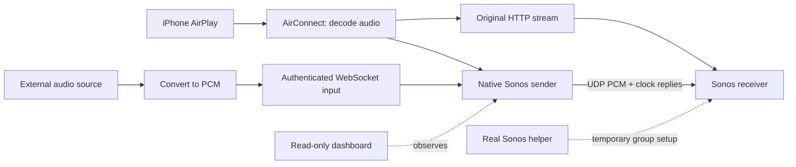

# AirConnect-Sonos

AirPlay to Sonos, with room naming built into the bridge, optional native UDP audio, a local status dashboard, and a microphone/intercom input.

This is a **modified fork of [Philippe's AirConnect](https://github.com/philippe44/AirConnect)**, maintained by [Thomas Dye](https://github.com/thomasdye12). The original AirPlay bridge, discovery and codec work come from AirConnect and its dependencies. This is not an independently created AirPlay stack or an official Sonos/Apple product. See [attribution](NOTICE.md), [LICENSE](LICENSE), and the preserved [upstream documentation](README.upstream.md).

## Start here

| You want to… | Read this |
| --- | --- |
| Install the bridge from scratch or upgrade it | [Installation](docs/INSTALL.md) |
| Understand the audio path and why a helper is needed | [How it works](docs/ARCHITECTURE.md) |
| Send live audio from another application | [Intercom installation and protocol](docs/INTERCOM.md) |
| Run it, change rooms, read logs or recover from a failure | [Operation and troubleshooting](docs/OPERATIONS.md) |
| See what has actually been tested | [Validation and known limitations](docs/VALIDATION.md) |
| Build or work on the code | [Build details](CUSTOM.md), [source map](docs/ARCHITECTURE.md#source-map) |
| Explore the earlier protocol experiments | [Research guide](research/sonos-native/README.md), [historical notes](README.history.md) |

**Use the `sonos-improvements` branch for the current implementation.** The published [v1.12.4-tds4 prerelease](https://github.com/thomasdye12/AirConnect-Sonos/releases/tag/v1.12.4-tds4) contains the older AirPlay binary and controller. It does **not** contain the subsequent dashboard/intercom additions and October 15 recovery fixes. Build current source to get those changes; this documentation update does not publish a new binary release.

## What it does

- Advertises Sonos rooms as AirPlay destinations, for example `Kitchen (Sonos)`.
- Reads names and coordinator identities directly from a compatible Sonos HTTP API's `/zones` endpoint. The former external room-naming script is unnecessary. A validated cache can cover an API outage for up to 24 hours.
- Offers the original UPnP/HTTP audio path and an opt-in native Sonos UDP path.
- Reuses one configurable Sonos helper to prepare different receivers, then releases it while each stream continues independently.
- Provides a read-only HTTP dashboard with service health, room state, native ownership, recent sessions and diagnostics.
- Accepts authenticated live PCM over WebSocket for intercom use. External applications can use the input independently of AirPlay.
- Adds bounded queues, cleanup/restoration, connection diagnostics and short scheduling-stall recovery for intercom.



## Requirements and scope

The documented deployment is a first-generation UniFi CloudKey running ARMv7 hard-float Linux with systemd. Builds were also tested on Apple Silicon macOS. The supplied installation paths and service units are Linux-specific. Other architectures need matching compiler settings and dependency archives; an ARMv7 binary is not a universal Raspberry Pi, ARM64, x86 or Docker image.

Native UDP needs **a real Sonos helper and a separate receiver**, both stopped and in standalone groups at session start. No line-in cable or Connect-specific line-in action is needed. The helper is used for setup, not as the ongoing audio relay. This does not enroll a virtual speaker into the Sonos household.

Separate phones can select different advertised rooms. This is **not AirPlay 2 synchronized multi-destination playback**. Initial helper setup is serialized; ongoing receiver sessions are separate. Intercom admits at most four sessions and refuses an already-owned receiver. Audible concurrent-session endurance remains unverified.

## Basic source workflow

```sh
git clone --branch sonos-improvements https://github.com/thomasdye12/AirConnect-Sonos.git
cd AirConnect-Sonos
sh prepare-source.sh
# On the tested ARMv7 hard-float Linux target:
sh build-cloudkey.sh
sh build-intercom.sh
```

Do not skip `prepare-source.sh`: it initializes pinned dependencies and applies the custom RAOP patch. A dirty `common/libraop` submodule afterwards is expected. Do not reset it or publish a replacement submodule pointer. Follow the [complete installation guide](docs/INSTALL.md) to configure and install the services; the build commands alone do not install anything.

An [experimental AirPlay 2 frontend](integrations/airplay2/README.md) is under development. It uses Shairport Sync with a timed Sonos worker; it is separate from the normal installer and is not yet a validated replacement for the current receiver.

## What is still experimental

| Area | Current position |
| --- | --- |
| Native audio | Short listening tests and live microphone sessions worked. Recovery has automated and muted live evidence; uninterrupted sound through recovery still needs listening confirmation. |
| Startup | Native setup commonly took about 5–8 seconds in this deployment. Wait for readiness before talking. This is separate from steady-state audio latency. |
| Latency and synchronization | Source timestamps and a per-room offset are supported. No measured mouth-to-speaker or acoustic lip-sync guarantee; no long-term resampling-based drift correction. |
| Pause | FLUSH clears pending AirPlay audio and keeps the session alive with silence. Sources that delay FLUSH can still leave a pause tail. |
| Track information and artwork | HTTP metadata handling was improved, but end-to-end display is incompletely validated. Images can be received/hosted; dynamic Sonos artwork is not working. Native title/artwork updates are not implemented. |
| Phone names | Uses a name supplied in the AirPlay request when available; otherwise an IP address. Discovery-based friendly device naming is not implemented. |
| Taking over playback | Native startup refuses playing/paused or grouped devices; it does not automatically interrupt music or dismantle existing groups. |
| Virtual Connect / pairing | Research remains incomplete. The operational native path still requires the real helper. |

See [validation](docs/VALIDATION.md) for the difference between listener confirmation, transmitted audio, and transport-only checks. A successful SOAP reply, a running worker or rising packet counter is not proof of audible playback.

## Sharing and attribution

The fork is based on AirConnect v1.12.4 at [`5fdb61e`](https://github.com/philippe44/AirConnect/commit/5fdb61e20de59bac5dbda9f6e2ed56ce549ccabd). Keep upstream credit and dependency licenses when redistributing it. Firmware, private captures, recorded audio, credentials and household configurations are not part of this repository.

For problems, include the component, Git commit or release, architecture, error text and a redacted log excerpt in [an issue](https://github.com/thomasdye12/AirConnect-Sonos/issues). Never include an intercom token, private key or unredacted configuration. Changes are recorded in [CHANGELOG.md](CHANGELOG.md).
