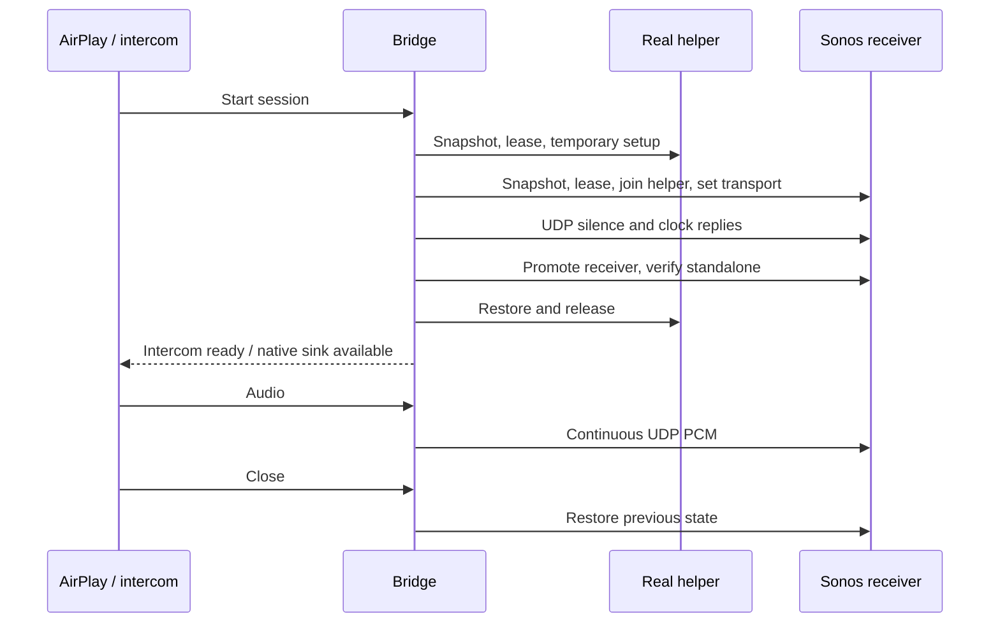

# How it works

AirConnect-Sonos extends Philippe44's AirConnect. It keeps the upstream AirPlay receiver, discovery and codec machinery, adds native Sonos room naming, and provides two audio outputs. The intercom and dashboard are separate processes so they can be updated without replacing the AirPlay process.

## Original HTTP output

An iPhone connects to an advertised AirPlay destination. The bridge receives and decodes its audio, makes an HTTP audio stream available, and uses Sonos UPnP control, including `SetAVTransportURI`, to tell the speaker where to fetch it. Sonos then retrieves and buffers that stream.

`SetAVTransportURI` is part of startup; it is not the whole latency. AirPlay's source timing, bridge encoding/queues, HTTP fetching and Sonos playback buffering also contribute. Reducing one buffer does not remove the others. This remains the default in the public example configuration.

## Native UDP output

The native path sends 44,100 Hz, signed 16-bit little-endian stereo PCM directly to the receiver's Sonos UDP audio endpoint. Each packet carries 251 stereo frames (1,004 audio bytes) plus protocol headers. The sender replies to clock requests on an allocated UDP socket and schedules audio with a 75 ms lead. That lead is a protocol scheduling value, **not measured end-to-end latency**.

A real helper is still required because transmitting correctly formatted PCM does not by itself establish a receiver's native group/source state. The implemented bootstrap uses normal speaker group control:

1. Acquire local ownership leases for the receiver and helper. Read their source, volume, mute and topology state. Both must be stopped and standalone.
2. Temporarily mute and join the receiver to the helper using `x-rincon:` control, then direct the receiver's native transport to the bridge's audio/timing endpoints.
3. Start the sender with silence while preparing the receiver. Promote the receiver to coordinator with a synthetic stream identity and detach the helper if necessary.
4. Verify each device's own coordinator identity, address and standalone membership. Restore and release the helper. Its cached view of another group is not authoritative for that other group's current membership.
5. Continue audio from the bridge directly to the receiver. On termination or failure, attempt verified restoration of the receiver and release its lease.

The helper is not forwarding ongoing audio, and no line-in cable is needed. A single configured helper can prepare multiple different receivers in sequence while existing streams continue. Setup is serialized through its lease; setup calls and lease waits are bounded, so simultaneous requests can still time out. Intercom admits at most four sessions. Independent room sessions are not AirPlay 2 synchronized multiroom playback.

This does not create an enrolled virtual Sonos device, replace household certificates, or complete virtual Connect pairing. Those experiments remain in [research](../research/sonos-native/README.md). The current approach avoids needing a virtual enrollment implementation, but retains the physical helper dependency.

## AirPlay timing and pause

The patched RAOP receiver exposes a PCM sink alongside its original HTTP interface. It derives presentation timing from AirPlay sync packets and the receiver delay negotiated in `RECORD`. A room-specific `native_sync_offset_ms` can shift local presentation; positive values delay audio. HTTP hold-depth/drift handling is bypassed for native PCM.

The tds4 correction tracks a continuous submitted-sample cursor. Previously, comparing the next decoded block against a packetizing write's return time could insert silence into otherwise contiguous audio. The cursor prevents that repeated insertion. Small clock differences within 20 ms do not rewrite contiguous PCM; larger discontinuities realign with diagnostics. There is no speaker-DAC feedback or resampling-based drift correction yet.

`FLUSH` clears pending source audio while preserving the native sink with silence. TCP disconnect or `TEARDOWN` closes the sink and restores the speaker. The time between a user's pause tap and the source sending `FLUSH` can still affect the pause tail. A local sync offset cannot fix that control delay.

## Intercom input

The [intercom service](INTERCOM.md) accepts PCM over an authenticated WebSocket. An external application converts its audio to the required format and sends it after the bridge reports readiness. It does not require an AirPlay connection.

The bridge checks the source IP, bearer credential, room and format before starting a separate C worker. It sends `ready` only after helper release/restoration. Microphone PCM must wait for that response. In this deployment, preparation commonly took about 5–8 seconds; this delay is separate from mouth-to-speaker latency.

The worker primes 60 ms and bounds its PCM queue at 200 ms. It fills underruns with silence and discards old queued frames on overflow. Intercom can recover a 250–500 ms scheduling stall by advancing future deadlines, preserving packet/sample sequence and discarding queued stale PCM. Recovery may leave an audible gap. Longer scheduling stalls fail, and pipe congestion is bounded at 750 ms. These recovery settings are intercom-specific; AirPlay retains strict native pacing.

On disconnect, the service requests graceful worker shutdown/restoration and ultimately terminates a worker that does not exit. An error or forced termination must not be interpreted as verified restoration: inspect the result and the Sonos app.

## Naming, metadata and monitoring

Room naming comes from a compatible Sonos HTTP API's `/zones` response. Only coordinators are selected. Names and membership load at startup; a validated API-bound cache can cover an outage for up to 24 hours. This removes the external naming script, not the API dependency.

HTTP title/artist handling and image reception were improved. Hosting an iPhone image does not make Sonos display it: dynamic artwork is not working, and native UDP title/artwork updates are not implemented. A sender-supplied device name is used where available; otherwise the bridge falls back to its IP.

The dashboard reads service/config/log information and local intercom status. It does not control playback or receive the intercom credential. Ownership displays consult actual file locks, not merely the presence of old lock files. Native AirPlay and intercom on the same host share leases; unrelated controllers and the HTTP path do not participate.

## Source map

| Path | Responsibility |
| --- | --- |
| `airupnp/src/sonos_native.c` | Native lifecycle, SOAP setup, topology checks, helper release, ownership and restoration |
| `patches/libraop-tds.patch` | AirPlay metadata/artwork improvements and PCM sink/timing integration |
| `research/sonos-native/native/` | Native packet, clock and paced sender implementation; standalone tests |
| `tools/intercom_worker.c` | PCM input queue and native intercom worker |
| `tools/airconnect_intercom.py` | Authenticated WebSocket admission, worker supervision, status and cleanup |
| `docs/INTERCOM.md` | Generic intercom setup and PCM input contract |
| `tools/airconnectctl.py` | Status, room list, helper/native settings and bounded research commands |
| `tools/airconnect_dashboard.py`, `tools/dashboard/` | Read-only HTTP monitor and browser assets |
| `deploy/` | Example configuration, Linux units and component installers |
| `tests/` | Parser, RAOP, controller, lifecycle, intercom and dashboard checks |

See [installation](INSTALL.md) for commands and [validation](VALIDATION.md) for the evidence behind current claims.
